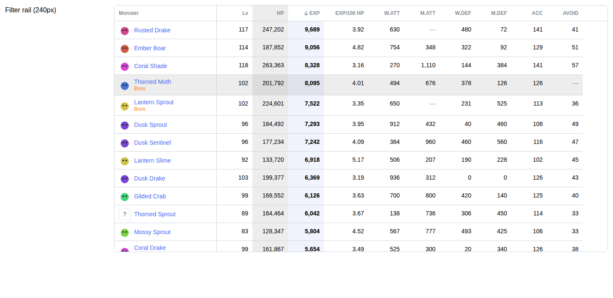
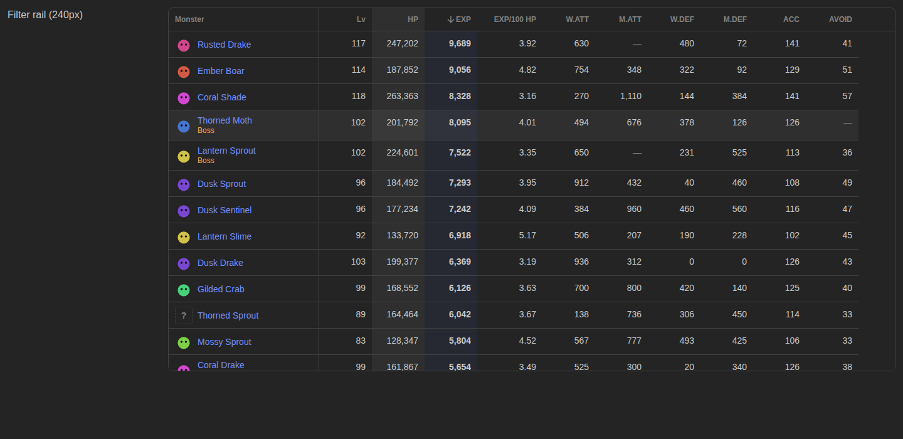
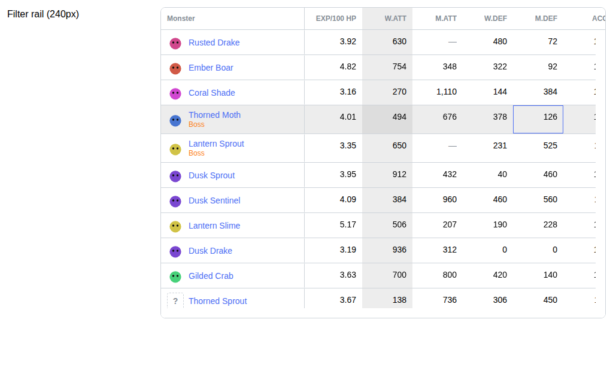
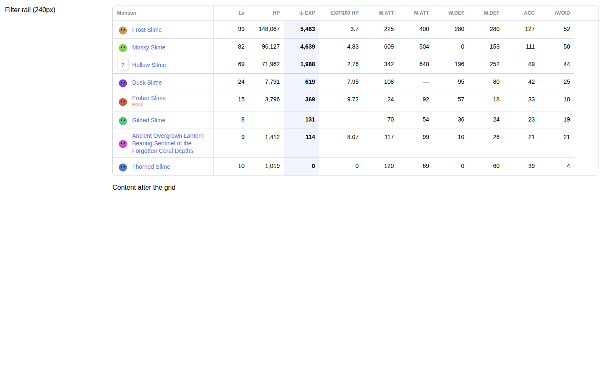
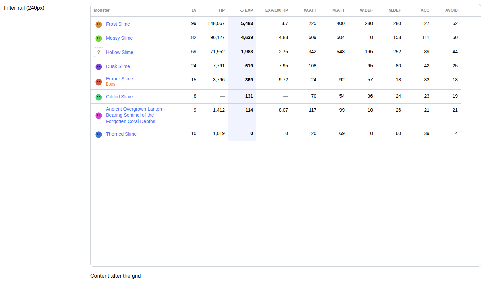
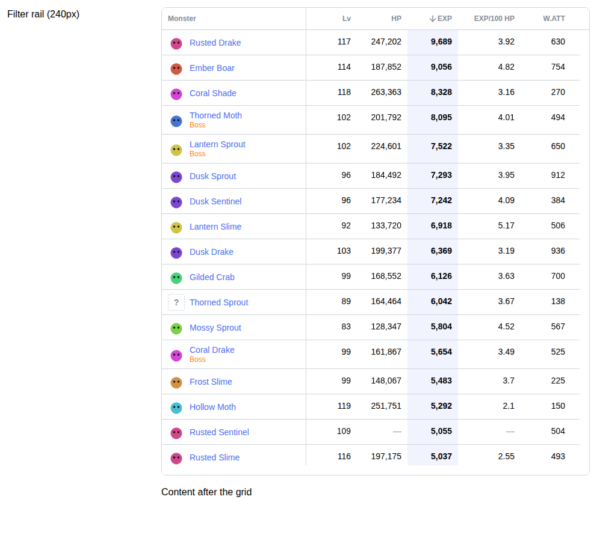

# AG Grid Community spike — evidence report

**Question:** can AG Grid Community supply the desktop comparison table for the
Faceted Browser without MapleTip-specific table infrastructure?

**Answer:** provisionally yes, with constraints. Final adoption is pending the
accessibility gate and decisions D1–D4. See
[the recommendation](./README.md#1-recommendation).

Labels used below:

- **[verified]**: confirmed from package metadata, type definitions or vendor
  docs.
- **[measured]**: observed in a real browser by the spike's tests or probes.
- **[judgment]**: an architectural opinion.
- **[unverified]**: not tested.

## 1. What was built

All files live in `packages/component-library/src/spikes/ag-grid/`. Nothing here
is exported from the package. AG Grid is a `devDependency` because only the
spike uses it.

| File                                | Purpose                                                                                                                                                                                                                                                                            |
| ----------------------------------- | ---------------------------------------------------------------------------------------------------------------------------------------------------------------------------------------------------------------------------------------------------------------------------------- |
| `fixtures.ts`                       | 100 deterministic synthetic Monster-like records (seeded PRNG): long name, missing sprites, unknown vs zero, boss trait. Also a stand-in for the query-layer sort.                                                                                                                 |
| `comparisonGridTheme.ts`            | `themeQuartz.withParams(...)` taking colours, fonts and borders from Mantine CSS variables. `autoHeightMaxBodyHeight` reads `--comparison-grid-max-body-height`. No new token system.                                                                                              |
| `MonsterComparisonGrid.tsx`         | `AgGridReact` with domain-style column definitions and cell renderers. Layouts: `fixed`, `auto` and `bounded`. Supported options only.                                                                                                                                             |
| `MonsterComparisonGrid.module.css`  | Domain cell styles and the spike's layout variables.                                                                                                                                                                                                                               |
| `ResponsiveResultsProbe.tsx`        | D2/D4 probe. Always-rendered cards (CSS-hidden from `md`) plus a client-only grid behind `React.lazy(() => import(...))`, mounted when Mantine `useMediaQuery('(min-width: 62em)')` matches.                                                                                       |
| `MonsterComparisonGrid.stories.tsx` | Stories `FixedHeight`, `AutoHeight`, `BoundedLong`, `BoundedShort`, `FixedShort`, `ResponsiveProbe`, `Unsorted` and `Dark`. The throwaway harness provides a sticky header, a 240 px rail, a Mantine column menu, URL-state display and Mantine `Pagination` rendering `<a href>`. |
| `MonsterComparisonGrid.test.tsx`    | 32 browser tests.                                                                                                                                                                                                                                                                  |
| `ResponsiveResultsProbe.test.tsx`   | 3 browser tests (SSR output, mobile, desktop).                                                                                                                                                                                                                                     |

AG Grid configuration used. Every item is a documented API; there is no custom
event engine:

- **Modules:** `ClientSideRowModelModule`, `ColumnHoverModule`,
  `CellStyleModule`, `RowAutoHeightModule`, `TooltipModule`, and
  `ValidationModule` in dev builds only.
- **Display options:** `columnHoverHighlight`, `pinned: 'left'`,
  `type: 'rightAligned'`, `autoHeight` + `wrapText` (identity column only),
  `cellClassRules`, `enableCellTextSelection`, `ensureDomOrder`.
- **Layout:** `domLayout: 'autoHeight'` + `autoHeightMaxBodyHeight`.
- **Sorting:** `suppressMultiSort`, `onSortChanged`, and `postSortRows` that
  keeps the query layer's order.
- **Keyboard:** `tabToNextCell={() => false}`, and an `onCellKeyDown` handler
  where Enter activates the cell's link.

Run it:

```sh
pnpm storybook     # Spikes / AG Grid / Monster comparison
pnpm test          # 35 spike tests + story tests (Chromium)
```

## 2. Platform facts

| Fact                                                                                                                                                                                                                             | Status     |
| -------------------------------------------------------------------------------------------------------------------------------------------------------------------------------------------------------------------------------- | ---------- |
| `ag-grid-community` and `ag-grid-react` **36.2.0**, published 2026-09-16, both MIT. `ag-grid-react` peers React `^16.8 … ^19`; it runs on React 19.3.1 here.                                                                     | [verified] |
| Community includes sorting, pagination, column pinning, column hover, ARIA and keyboard navigation, and the theming API. Multi-column sorting, the Columns tool panel/side bar and the server-side row model are **Enterprise**. | [verified] |
| `autoHeightMaxBodyHeight` (theme param): "Once the rows exceed this height the grid stops growing and scrolls internally with row virtualisation… Has no effect in normal or print layout."                                      | [verified] |
| Theme params accept any CSS string (including `var()`). Theme CSS is injected at runtime and the package ships no CSS file.                                                                                                      | [verified] |
| No Enterprise package is installed.                                                                                                                                                                                              | [verified] |
| AG Grid 36 renders **one `role="row"` element per row** holding both pinned and scrolling cells. One `role="grid"` viewport scrolls both axes natively.                                                                          | [measured] |

## 3. Requirement results

Browsers: Chromium, Firefox and WebKit from the `mcr.microsoft.com/playwright:v1.64.1`
container. **105/105 runs pass (35 tests × 3 browsers).** These verify DOM
semantics, focus and keyboard behaviour. **They are not screen-reader or
forced-colors verification.**

| Requirement                                 | Result                                                                                                                                                                             | Evidence                                                                                                                    | Status     |
| ------------------------------------------- | ---------------------------------------------------------------------------------------------------------------------------------------------------------------------------------- | --------------------------------------------------------------------------------------------------------------------------- | ---------- |
| Row hover                                   | Built in. The single row element (pinned and scrolling cells) gets `ag-row-hover`.                                                                                                 | test "hovering a cell highlights its row…"                                                                                  | [measured] |
| Column hover                                | Built in (`columnHoverHighlight`). Cells and header get `ag-column-hover`, including on the pinned column.                                                                         | tests "…and its column", "hovering the pinned identity column…"                                                             | [measured] |
| Intersection                                | Translucent `rowHoverColor` + `columnHoverColor` stack, so the intersection is visibly darker. **No custom code.**                                                                 |                   | [measured] |
| Sorted-column indication                    | The header arrow is built in. A cell tint needs `cellClassRules` plus `refreshCells` (3 lines).                                                                                    | test "sorted column cells carry the sorted class…"                                                                          | [measured] |
| Keyboard focus                              | Arrow-key cell focus with a visible focus ring. Focus does not apply row or column highlight.                                                                                      | test "arrow keys move cell focus",                                 | [measured] |
| Pinned identity + horizontal overflow       | Native scroll; the identity column is stable at every tested width.                                                                                                                | tests "horizontal overflow at 1024px…", width matrix                                                                        | [measured] |
| **Bounded height, short results (D1)**      | 8 rows: bounded grid is **408 px** and fits its rows; fixed grid is **780 px**, mostly empty.                                                                                      | test "short result set…",   | [measured] |
| **Bounded height, long results (D1)**       | 100 rows: the grid caps at 779 px (body cap 740 px), virtualises (13–28 rows in DOM), and the header stays in place while the body scrolls.                                        | test "long result set…"                                                                                                     | [measured] |
| **Header visibility (D1)**                  | Visible while scrolling inside the grid body (fixed and bounded). **Not page-sticky:** once the page scrolls past the grid top, the header leaves the viewport (bounded and auto). | tests "bounded header is not page-sticky…", "auto-height header scrolls away…"                                              | [measured] |
| Auto height, unbounded                      | Renders all 100 rows in batches (13–14 on the first frame) and has no sticky header.                                                                                               | tests                                                                                                                       | [measured] |
| **Rail + table widths (D3)**                | 992 px: 5/10 numeric columns visible. 1 024: 6/10. 1 280: 9/10. 1 440: 10/10. No page overflow at any width.                                                                       | test "%ipx: rail + table…",                                                       | [measured] |
| **Indexable HTML (D2)**                     | Probe `renderToString` output: 31 150 chars containing **100/100 entity links** and no grid markup; the grid module is not requested during SSR.                                   | test "server render contains every card link…"                                                                              | [measured] |
| **Mobile import boundary (D4)**             | At 375 px: cards visible, no `role="grid"`, lazy loader **never called**. At 1 440 px: loader called once, grid mounted, cards `display: none`.                                    | probe tests                                                                                                                 | [measured] |
| ARIA                                        | `role="grid"`, `aria-rowcount="101"`, `aria-sort` on headers.                                                                                                                      | test "exposes ARIA grid semantics…"                                                                                         | [measured] |
| Sort by keyboard                            | Enter on a focused header sorts.                                                                                                                                                   | test                                                                                                                        | [measured] |
| Tab                                         | Default: cell-to-cell (about 1 100 stops). With `tabToNextCell={() => false}`: **one Tab stop**, in and out (ARIA grid pattern).                                                   | tests                                                                                                                       | [measured] |
| Links in cells                              | Cells, not contents, take focus. Enter activates the link via `onCellKeyDown`. Ctrl-click is not intercepted.                                                                      | tests                                                                                                                       | [measured] |
| Controlled sorting                          | `onSortChanged` → owner state/URL → query-sorted rows → `postSortRows` keeps that order (unknown last).                                                                            | tests                                                                                                                       | [measured] |
| Shareable URL                               | Sort and page in owner state; Mantine `Pagination` renders `<a href>`. **Sort headers are not links.**                                                                             | stories                                                                                                                     | [measured] |
| Column visibility                           | `hide` (Community); the menu is Mantine `Popover` + `Checkbox.Group` (the tool panel is Enterprise).                                                                               | test, story                                                                                                                 | [measured] |
| Unknown vs zero, missing sprite, long names | Domain cell renderers; long names wrap and the row grows.                                                                                                                          | tests                                                                                                                       | [measured] |
| Theme from Mantine tokens                   | Light and dark follow Mantine variables.                                                                                                                                           | screenshots                                                                                                                 | [measured] |

## 4. Performance and footprint

| Metric                                                              | Result                                                                                                                                             | Status                    |
| ------------------------------------------------------------------- | -------------------------------------------------------------------------------------------------------------------------------------------------- | ------------------------- |
| Mount → `firstDataRendered`, 100 × 11                               | 131–521 ms across runs and browsers (remote harness overhead included)                                                                             | [measured]                |
| Sort: `onSortChanged` → reordered first row (auto height, 100 rows) | 196–344 ms. Not measured in the bounded/virtualised layout.                                                                                        | [measured]                |
| Production build of the probe entry (cards + lazy grid)             | Entry chunk 266 KB raw / **82.6 KB gzip**, containing **no AG Grid code**. The grid chunk, loaded via `import()`, is 745 KB raw / **207 KB gzip**. | [measured]                |
| Incremental cost vs a React-only baseline (earlier probe)           | +742 KB raw / +206 KB gzip                                                                                                                         | [measured]                |
| `mantine-datatable@9.4.0` for comparison                            | 55 KB raw / 16.6 KB gzip JS + 3 KB gzip CSS (package files)                                                                                        | [measured]                |
| Server render of the grid alone                                     | 75-byte empty shell; no row text                                                                                                                   | [measured]                |
| Desktop hidden-card cost                                            | About 31 KB of HTML for 100 minimal cards (real cards will be heavier)                                                                             | [measured, minimal cards] |

No performance targets are proposed yet. Budgets will be derived from P1–P3
measurements.

## 5. Constraints and gaps (no bespoke rescue attempted)

1. **No page-sticky header.** The header stays visible only while scrolling
   inside the grid body. Bounded auto height is the simplest supported layout
   that also avoids empty space for short results.
2. **No server-rendered rows.** Indexable HTML comes from the always-rendered
   cards.
3. **Grid chunk about 207 KB gzip**, desktop only, behind a dynamic import.
4. **Links in cells are not Tab-reachable** (ARIA grid model); arrows + Enter
   reach them. **Screen-reader behaviour is untested.**
5. **Sort headers are buttons, not links.**
6. **Column chooser UI** is Enterprise; Community supports `hide`, with a
   Mantine menu.
7. **Dev-only validation overlay.** With `ValidationModule`, the first grid on a
   page shows an on-screen "AG Grid found 2 warnings" panel (warning #9:
   `--ag-row-border` and `--ag-pinned-row-border` read before styles loaded).
   Later grids do not. Production builds exclude `ValidationModule`; to be
   investigated in P1.

## 6. Required before production adoption (not yet done)

- **Screen readers:** NVDA + Firefox and VoiceOver + Safari. Cover sort
  announcements, row/column context with virtualised rows (`aria-rowcount` vs
  DOM rows), link activation, and leaving the grid.
- **Forced colors** (Windows High Contrast) for hover, focus, sorted tint and
  unknown values.

## 7. Other unverified items

- Real touch devices: tap behaviour and momentum scroll inside the bounded
  body.
- Visible classic scrollbars at 992–1 280 px. Headless browsers use overlay
  scrollbars, and AG Grid reported them as invisible.
- Frame timing during sort and scroll; memory.
- Real middle-click (only a synthetic Ctrl-click was dispatched).
- Real card markup cost on desktop.

## 8. Harness notes

- The first `userEvent.hover` in an ad-hoc screenshot script timed out
  regardless of colour scheme. This looks like the harness's first viewport
  resize; the suite's hover tests pass in all three browsers.
- Vite re-optimised dependencies once after `react-dom/server` was first
  imported into a warm cache, and that run failed. A cold-cache full run passed
  (40/40 at the time, now 44/44).
